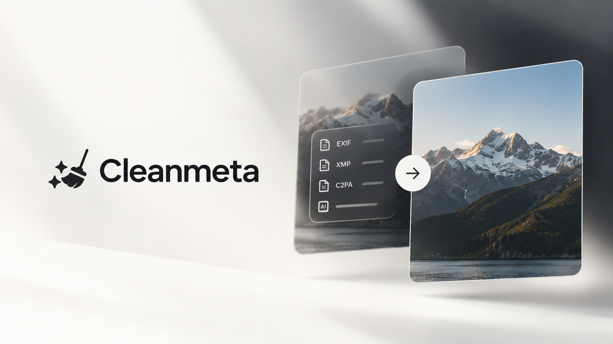

# Cleanmeta — Minimal Image Metadata Cleaner

> **Your images. Your metadata.**  
> A fast, privacy-first web utility for inspecting and removing embedded EXIF, GPS coordinates, camera hardware identifiers, XMP packets, and AI provenance records from your images — 100% browser-local.

---

## ⚡ Overview

When photos are captured or generated, image files silently carry invisible metadata headers alongside visual pixels. **Cleanmeta** allows you to inspect everything your image contains and strip sensitive information before sharing, publishing, or archiving.

All processing occurs entirely inside your local browser memory using isolated canvas re-encoding. No images, files, or thumbnails ever leave your device.

---

## ✨ Features

- **🔍 Comprehensive Metadata Inspection**
  - **Camera EXIF Data**: Camera make, model, lens model, focal length, aperture ($f$-number), ISO, exposure time, and capture timestamps.
  - **GPS Geolocation**: Latitude, longitude, and altitude with direct one-click navigation to Google Maps.
  - **AI Provenance & Parameters**: Detects generator signatures (Stable Diffusion, Midjourney, ComfyUI, DALL-E), extracted prompts, samplers, model hashes, and C2PA Content Credentials.
  - **Tabular Raw Explorer**: Search and view every raw metadata tag embedded in the image file.

- **🧹 100% Client-Side Metadata Stripping**
  - Re-encodes visual pixels onto an isolated in-memory canvas, discarding all metadata headers (APP1, APP13, XMP, IPTC, ICC profiles, and C2PA manifests).
  - **Physical Orientation Normalization**: Corrects camera EXIF rotation flags directly onto pixels so images never appear sideways after EXIF removal.
  - **Lossless PNG Transparency**: Preserves alpha channels and transparency layers.

- **📊 Re-inspection Verification & Audit**
  - Automatically re-inspects the stripped output file to verify and prove that **0 metadata tags** remain.
  - Storage impact audit displaying exact byte-level file size reduction and percentage savings.

- **🎛️ Export Controls**
  - Convert or maintain format: **Original**, **PNG**, **JPEG**, or **WebP**.
  - Adjustable quality compression slider (80%–100%) for lossy formats.

- **🧪 Interactive Sample Photos**
  - Built-in test files with authentic Camera EXIF + GPS and AI Art (SDXL + Prompts + C2PA) to test the tool instantly without uploading your own photos.

---

## 🔒 Privacy & Platform Notice

- **No Remote Servers**: Cleanmeta has no server-side image processing. Your photos are never uploaded or stored anywhere.
- **Social Platform Notice**: Removing file metadata strips embedded headers, tags, and digital manifest records. However, social media platforms (such as Instagram, TikTok, and YouTube) also use independent perceptual watermarking (e.g., SynthID) and computer vision classifiers that inspect visual pixels directly. Stripping metadata does not guarantee third-party platforms will remove their automated AI labels.

---

## 🛠️ Tech Stack & Design System

- **Framework**: React 19 + TypeScript + Vite
- **Design System**: Aster DS (`aster-ds`) with 8pt spatial baseline and semantic color tokens
- **Typography**:
  - Display: Bebas Neue (`--as-typography-font-family-display`)
  - Body: Manrope (`--as-typography-font-family-sans`)
  - Mono / Data: Space Mono (`--as-typography-font-family-mono`)
- **Metadata Engine**: `exifr` + custom binary parser for PNG text chunks and C2PA signatures
- **Styling**: Tailwind CSS v4 + Aster DS master stylesheets
- **Icons**: Lucide React

---

## 🚀 Getting Started

### Prerequisites
- Node.js 18+
- npm or yarn

### Installation

```bash
# Clone the repository
git clone https://github.com/your-username/cleanmeta.git

# Enter the directory
cd cleanmeta

# Install dependencies
npm install

# Start local development server
npm run dev
```

Visit `http://localhost:3000` to view the application.

### Production Build

```bash
npm run build
```

---

## 👤 Author

Created by **[Irtiza Khan Labib](https://irtizakhanlabib.vercel.app/)**
